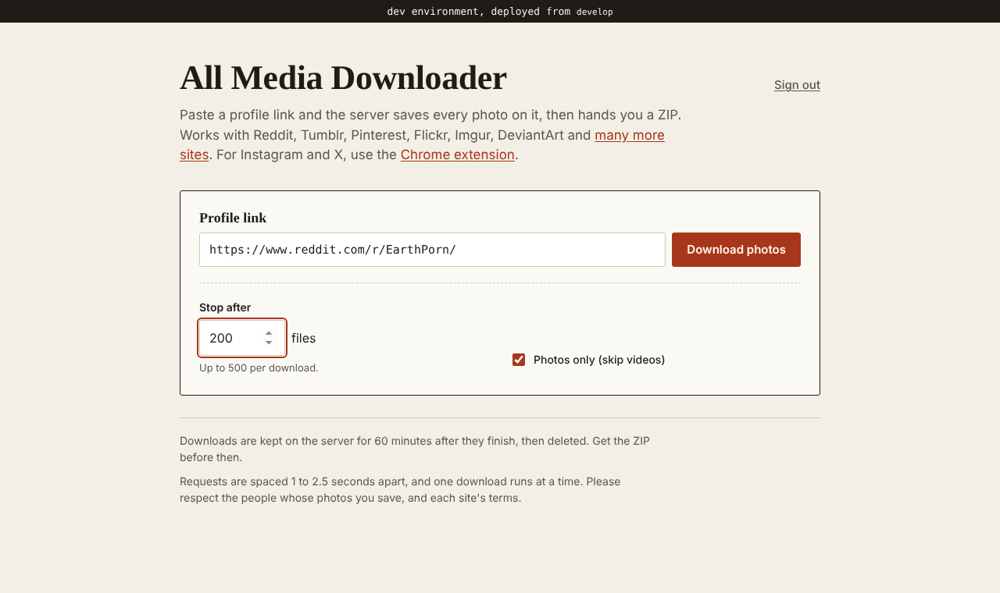

# All Media Downloader

Save every photo on a social media profile. There are two parts:

| | What it is | Best for |
|---|---|---|
| **Website** (`web/`) | A password-protected site. Paste one profile link or up to 50 post links and get a ZIP. Profiles and most posts use [gallery-dl](https://github.com/mikf/gallery-dl); Instagram, X, TikTok and Facebook posts use the [FastSaver API](https://api.fastsaver.io/docs). | Profiles: Reddit, Tumblr, Pinterest, Flickr, Imgur, DeviantArt and [about 300 other sites](https://github.com/mikf/gallery-dl/blob/master/docs/supportedsites.md). Posts: all of those plus Instagram, X, TikTok, Facebook. |
| **Chrome extension** (`extension/`) | Open a profile or a post, click the icon, press Save photos. It runs in your browser with your own login. | Instagram and X profiles and posts, Reddit, and most photo sites. |

Download page: **https://rchalasani93.github.io/all-media-downloader/dev/** (built from `develop`)



## Environments

| Branch | Download page (GitHub Pages) | Website (Render) |
|---|---|---|
| `develop` | `/all-media-downloader/dev/` | https://all-media-downloader-dev.onrender.com (`render.yaml`) |
| `main` | `/all-media-downloader/` | not set up yet |

Every push to `main` or `develop` runs the website tests, the extension tests and a dependency audit. The download page is then rebuilt from both branches (`.github/workflows/pages.yml`). Render deploys the website on its own whenever `develop` changes.

## One-time website setup (Render, free plan)

1. Sign in at [render.com](https://render.com) with GitHub.
2. Click **New** → **Blueprint**, pick this repo, and choose the `develop` branch.
3. When Render asks for `ACCESS_PASSWORD`, enter the password you'll sign in with (at least 8 characters). `SECRET_KEY` is generated for you.
4. Once it's live, put its URL in `deploy/environments.json` under `dev.web_url`, so the download page links to it.

### Single posts on Instagram, X, TikTok and Facebook

These go through FastSaver, because those sites block servers. Create a key at [api.fastsaver.io](https://api.fastsaver.io/auth) and add it in Render under **Environment** as `FASTSAVER_API_KEY`. It stays on the server and is never logged or sent to the browser. Posts cost 1.5 credits each, the free plan has 1,000 credits and 10 requests a minute, and the server spaces its calls to stay under that. On a paid plan, set `FASTSAVER_RPM` to the plan's limit. Downloads stop early if the key is rejected or the credits run out.

The free plan sleeps after 15 minutes without visits, so the first load can take about 30 seconds. Files live on temporary disk and are deleted an hour after each download.

## Installing the extension

1. Download `all-media-downloader-extension.zip` from the download page and unzip it.
2. Go to `chrome://extensions`, turn on **Developer mode**, click **Load unpacked**, and pick the unzipped folder.
3. Open a profile (e.g. `instagram.com/natgeo` or `x.com/NASA/media`), click the icon and press **Save photos**.

Photos are saved to `Downloads/AllMediaDownloader/<site>_<profile>/`. Keep the tab open while it collects.

On a single post (Instagram `/p/…` or `/reel/…`, X `/status/…`, Reddit `/comments/…`) it saves just that post, including every image in a carousel or gallery.

How it finds photos on profiles:
- **Instagram:** Instagram's own web API, called from the profile tab with your login. Gets full-size images, including every image in carousels.
- **Reddit:** Reddit's JSON listings for users and subreddits, including galleries.
- **X, Pinterest, Tumblr and other sites:** scrolls the page and collects the large images, then asks the CDN for the original size where it can.

## Security

**Website:** single access password with rate-limited sign-in (5 per minute), a signed session cookie (HttpOnly, Secure, SameSite=Lax), CSRF tokens and Origin checks on every POST, and a Host allowlist. Jobs are tied to the session that started them, so other sessions can't read them. Links are checked against gallery-dl's site list. Media links returned by FastSaver must be https and resolve to public addresses, re-checked on every redirect, with a per-file size cap and a content-type allowlist. Direct links and links that resolve to private or cloud-metadata addresses are refused (SSRF). gallery-dl runs with an argument list and no shell. Files are served from the job folder only, images only, under a sandbox CSP. It also caps files and MB per download, runs one download at a time, rate-limits job starts, sets strict headers with HSTS, keeps debug off, never shows stack traces, and gets secrets from environment variables only.

**Extension:** the only permissions are `activeTab`, `scripting`, `downloads` and `storage`. It can touch a page only when you click its icon there. It has no remote code and no analytics, and sends nothing anywhere except the downloads you ask for.

Please respect the people whose photos you save, and each site's terms.

## Development

```
pip install -r web/requirements.txt -r requirements-dev.txt
pytest -q tests/test_web.py
node --test tests/rules.test.mjs
APP_ENV=local python web/app.py        # http://127.0.0.1:8765, password: local
```
